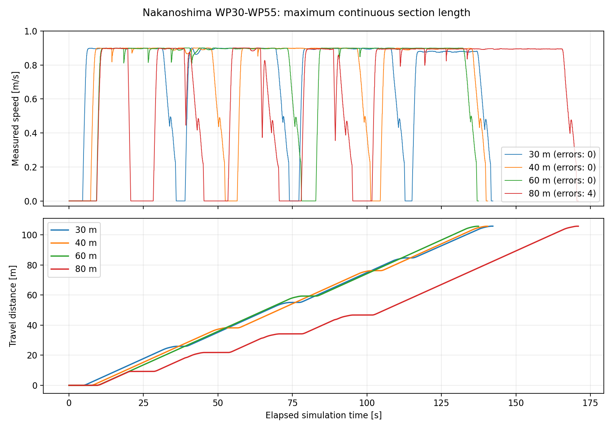

# 中之島ルートの連続区間長比較（2026-10-22）

今回比較した30/40/60/80 mでは、上限60 mが最短時間で空経路エラーも0回だった。現在のPC・設定での暫定推奨上限を60 mとする。全ルートや負荷条件を横断した数学的な最適値ではなく、エラーが出た場所を含む共通区間での各1回の比較結果である。

後続の全ルートbag（sim_nakanoshima3、50 m制限）ではWP21付近で空経路エラーが1回残った。以下の60 mという結果はWP30〜55の試験範囲に限る。詳細と次の検証候補は[50 m制限後の確認](SIM_NAKANOSHIMA_50M_REVIEW.md)を参照。

## sim走行結果

中之島の同じWP30からWP55まで約106 mを、同じ位置・向きから走行。元のルート125点のうち26点をコピーして使用し、元YAMLは変更していない。

| 区間長上限 | 完走時間（sim秒） | 移動距離 | 空経路エラー / 中断 | 送信したaction数 |
|---|---:|---:|---:|---:|
| 30 m | 142.26 | 105.73 m | 0 / 0 | 4 |
| 40 m | 140.52 | 105.67 m | 0 / 0 | 3 |
| **60 m** | **137.45** | **105.67 m** | **0 / 0** | **2** |
| 80 m | 170.96 | 105.70 m | 4 / 4 | 9（再試行を含む） |

全候補で完走し、失敗点スキップは0回。80 mでは`Resulting plan has 0 poses in it.`が4回再発し、単点再試行で継続した。60 mは30 mより4.81秒（約3.4%）、40 mより3.07秒（約2.2%）短い。小さい時間差は各1回の試験の変動を含み、統計的優位を確認したものではない。

60 mの試験ではWP30〜44とWP45〜55を送信。ポイント間隔に依存するため点数固定ではなく、経路に沿った距離の上限とする。ポイント間を補間して60 mちょうどの地点を作ることはしていない。

## 経路計算だけの測定

現在のsim用GridBased/Navfn設定と同じ5586×6649セルの静的地図を使い、開始点WP30/40/71の3か所でComputePathThroughPosesを測定した。動的scanなし・use_sim_time=false。下表はaction結果のplanning_timeの実時間で、上の走行表のsim時間とは区別する。

| 要求する区間長上限 | 計算時間の範囲 |
|---|---:|
| 10 m | 0.35〜1.20秒 |
| 20 m | 0.76〜1.47秒 |
| 30 m | 1.83〜2.60秒 |
| 40 m | 2.54〜3.30秒 |
| 60 m | 4.40〜5.19秒 |
| 80 m | 5.87〜6.93秒 |
| 120 m | 9.50〜10.24秒 |
| 160 m | 11.32〜13.21秒 |

各開始点から元の地点順に距離上限以内の点を含め、本来の停止点までで終了。次の1点までの距離自体が上限を超える場合はその1点を含む（WP71から次点までは約16 mのため、10 m条件でもこのケースは16.11 m）。要求上限と実際の距離・点数・計算時間はJSONに記録。

## 条件・測り方

- ワールドmap_0920_nakanoshima、params/sim/nav2.yaml、速度上限0.9 m/s。追従はNavigateThroughPoses。
- 検証用コピーで区間長の制限を追加。既存の急角度・終端近接の分割条件は維持。区間境界は従来どおりNav2到着完了を待つ。
- 自己位置推定はstatic。spawnと初期odomからmap→odom変換を合わせ、AMCLによる位置変動を除外。
- 検証用Nav2はLifecycleを順にconfigure/activateし、bond監視を無効化して起動の不定期なservice失敗を避けた。走行制御パラメータは元のsim設定を維持。
- 独立したROS/Gazeboドメインで試験。既存の実機・ユーザーのsimは操作していない。
- elapsed_sim_sは検証用followerの起動直前から終了確認までで、初回の計画・加速・各区間終端の到着待ち・最終減速を含む。
- 距離は/odomの|linear.x|を時間積分。経路誤差・衝突の有無を判定する指標ではない。
- 生の集計値: `reports/nakanoshima_section_length_20261022/drive_results.json`、`planner_results.json`。

## 適用範囲

60 mは今回の候補中の最良値。50/70 mなどの中間値、同条件の反復試験、全125地点、AMCL、実機、CPU高負荷条件では未確認。エラーなしの保証や全条件での最適値ではない。大きな負荷変動を見込む場合は40 mも比較候補になる。

元のwaypoint_follow.py・Nav2設定・ウェイポイント・起動スクリプトは変更していない。検証後、ユーザー指定により通常起動には当初50 m、その後40 mの上限と通常区間の早期更新（既定4 m）を適用した（実機・sim共通）。本表は30/40/60/80 mの測定結果で、50 mの実走結果は含まない。
