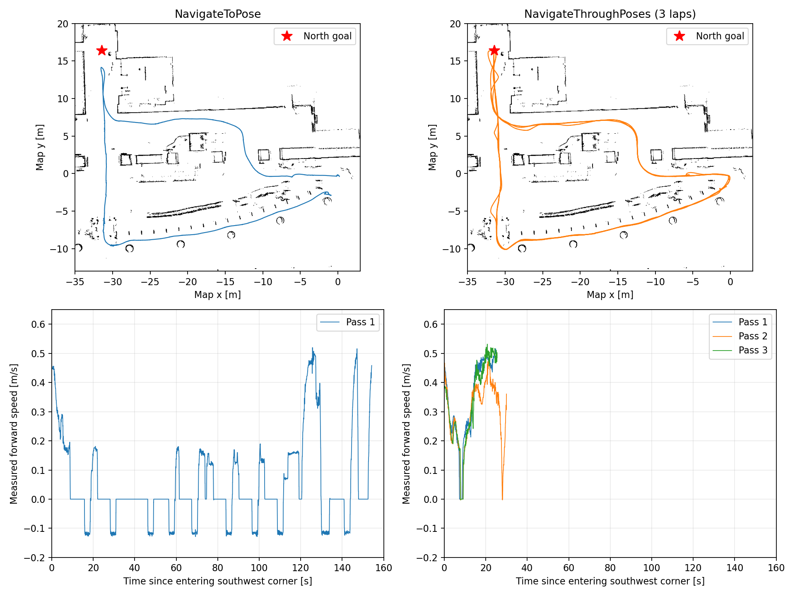

# 2026-10-21 実機rosbag比較（解析日2026-10-22）

今回の記録ではNavigateThroughPosesの方が、左下の曲がり角で停滞・後退を抑えて走行を継続し、上端の目標付近まで到達している。共通の直線区間では両方式とも約0.5 m/sを維持しており、「直線の最高速が大幅に向上した」という結果ではない。

## 入力

- NavigateToPose: `/home/ren/bag/1F-1021_0_fixed.mcap`（520.7秒、metadata `itumodoori`）
- NavigateThroughPoses: `/home/ren/bag/1F-1021-2_0_fixed.mcap`（1127.8秒、metadata `kaeta`）
- ファイルと方式の対応はユーザー確認済み。to_poseの切替距離は未確認。

## 同じ場所の比較

| 項目 | NavigateToPose | NavigateThroughPoses |
|---|---:|---:|
| 下側の共通直線の走行中平均速度 | 0.493 m/s | 0.505 m/s（3回合算） |
| 左下の曲がり角付近の滞在時間 | 154.2秒 | 各24.9 / 30.0 / 25.5秒 |
| 同エリアの静止時間 | 75.3秒 | 各1.3 / 1.4 / 1.3秒 |
| 同エリアの後退時間 | 29.1秒 | 0秒（3回合算） |
| 上端の共通目標への最接近距離（AMCL） | 2.27 m | 0.084 m |

共通目標は両bagの`/plan`終点で確認したmap座標(-31.4096,16.4024)。to_poseは上端の手前で折り返している。ThroughPosesは目標の近くまで進んでおり、上側の折り返しを速さだけで評価すると、この到達位置の違いが隠れる。

## 集計方法

- rosbagを再生せずread-onlyで読み取り。速度は`/odom`のlinear.x/angular.zを使用。
- 地図上の軌跡は`/odom/filtered`とmap→robot/odomの`/tf`を合成。上端目標の距離は`/amcl_pose`でも確認。
- 比較対象は最初の`/cmd_vel_nav`から最後の同メッセージまで。回数が違うため録画時間の総量を直接優劣の根拠にしていない。
- 共通直線: -26<x<-6、-9<y<-3、前進速度>0.05 m/s。時間重み付き平均。
- 左下曲がり角: x<-28、y<-5。エリア内の記録が5秒超途切れたら別の通過として集計。
- 静止: |linear.x|<0.03 m/sかつ|angular.z|<0.05 rad/s。後退: linear.x<-0.05 m/s。
- 表のエリアは軌跡比較用の幾何範囲であり、actionの開始・到着・成功時刻ではない。

## 解釈の限界と残る課題

- 旧方式の左下滞在中には約8秒の`/cmd_vel_teleop`記録がある。人の介入を含み、停滞の全量を自動制御の性能だけに帰属できない。
- ThroughPosesも上側折り返しエリアで約27〜46秒を要し、減速・静止が残る。to_poseは同じ上端位置まで到達していないため、ここの所要時間は同条件の比較ではない。
- 初期位置、周回数、障害物、操作、待機タスク、全パラメータが同一だったとは確認できない。action status/feedbackやBTログがなく、停止をリカバリー・指定待機・障害物等に確定分類できない。
- 方式変更と現象改善には対応があるが、方式だけが原因であると断定する比較実験ではない。接触の有無や安全性の優劣は、この集計では判定していない。
