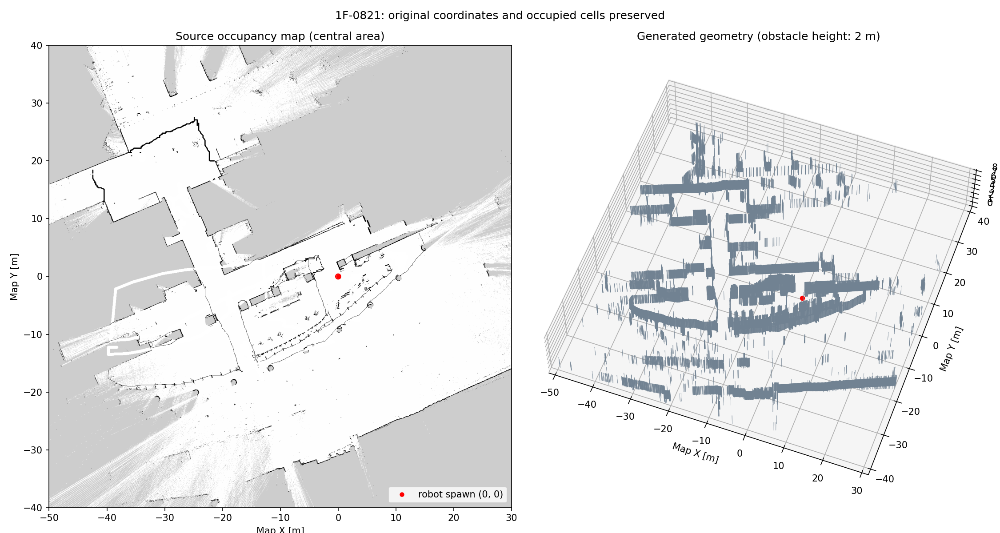

# 1F-0821 地図から生成したGazeboワールド

`maps_waypoints/maps/1F-0821.yaml` と `1F-0821.pgm` の占有セルを、
高さ2mの静的障害物にしたワールド。地図の座標・向き・縮尺は変更していません。
ランチャーのワールド選択では「1F-0821（実測地図・占有セルから生成）」を選択します。

## 起動

使用中のsimを通常の手順で終了してから、新しいsimを起動してください。

```bash
koko_sim --world-id map_1f_0821
```

別の端末で、選択ワールドに対応した地図と初期位置を使ってNav2を起動します。

```bash
koko_nav2_sim_map --world-current
koko_rviz_sim
```

実機と同じmap座標なので、`1F-0821` の既存ウェイポイントも座標を変換せず利用できます。
生成した障害物があるため、各地点・経路の走行可否はsim上で確認してください。
スポーン位置は `(x, y, yaw) = (0, 0, 0)`。地図上で半径0.45mの領域が既知の空きセルに入ります。

## 生成内容

- ワールド: `src/robotbase_sim/worlds/map_1f_0821.sdf`
- 障害物メッシュ: `src/robotbase_sim/models/map_1f_0821/meshes/occupied.obj`
- 対応地図: `src/robotbase_sim/maps/map_1f_0821/map.yaml`
- 地図画像: 元PGMの全画素を維持した可逆PNG。3931×3661、解像度0.05m。
- origin: `[-92.25, -105.25, 0]`
- 35,423個の占有セルを保存。細い壁・孤立セル・穴を削除せず、外面を結合した176,632三角形の単一メッシュを使用。
- 元画像のハッシュと生成条件: 同ディレクトリの `generation.json`
- 外部モデル・ネットワーク上の素材への依存はありません。



## 近似の範囲

2Dの占有地図には高さ・材質・見えない部分の形状がありません。
壁・柱・家具・計測ノイズを区別せず、占有セルを一律2mにしています。
未知セルには壁を追加せず、地図全体に床を敷いています。
実際の建物の3D形状や、実機のLiDAR反射特性を再現したものではありません。
特に地図中の孤立したノイズも障害物として残るため、実機の事故が同じ条件で再現する保証はありません。

## 再生成と検証

```bash
python3 src/robotbase_sim/scripts/generate_map_world.py
source /opt/ros/jazzy/setup.bash
colcon build --packages-select robotbase_sim --symlink-install
source install/setup.bash
gz sdf -k src/robotbase_sim/worlds/map_1f_0821.sdf
ROS_LOG_DIR=/tmp/robotbase-map-tests \
  PYTHONPATH=other_programs/sirius_launcher:$PYTHONPATH \
  QT_QPA_PLATFORM=offscreen python3 -m pytest -q \
  other_programs/sirius_launcher/tests/test_map_world.py \
  other_programs/sirius_launcher/tests/test_simulation_worlds.py
```

生成スクリプトはNumPy・Pillow・PyYAMLを使用します。
高さを変える場合は `--wall-height 2.5` のように指定できます。

2026-10-22の検証結果:

- SDFチェック成功、パッケージビルド成功、関連テスト9件成功。
- 独立したGazebo通信区画で落下テスト。自由領域の試験球は床面へ落下し、障害物上の試験球は高さ約2.02mで接触。地図全体を凸包で塞ぐ状態にはなっていません。
- 実行用のインストール済みSDFから、ROS Domain 219にロボットを起動。`/clock`・`/odom`・`/scan3`を確認。
- LiDARは720点中719点が有限値、最短距離約0.49m。スポーン位置の移動は1mm未満。
- ユーザーのROS Domain 67のsimは停止・変更していません。
- 自律走行による全域の走破試験は行っていません。
