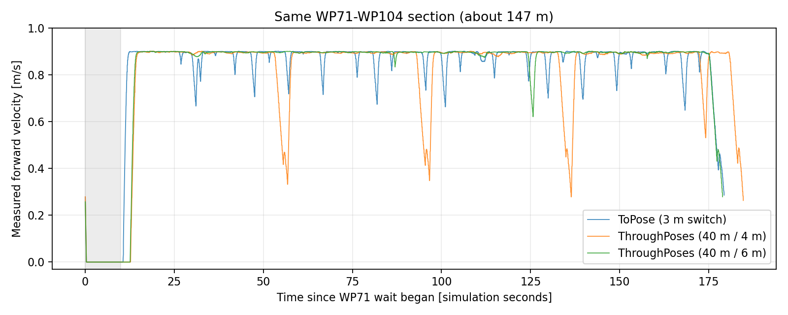

# sim_nakano5の確認（2026-10-22）

入力: `/home/ren/rosbag2_data/sim_nakano5/sim_nakano5_0.mcap`。metadataは`40m 6m`、ThroughPoses起動ログ、実際の早期更新ログも確認した。bagのread-only解析で、走行設定は変更していない。

## 共通区間WP71→WP104

始点の10秒待機を含み、終点の待機は含まない。速度は/odomの実測値。

| 指標 | to_pose（約3 m切替） | ThroughPoses 40 m/4 m | ThroughPoses 40 m/6 m |
|---|---:|---:|---:|
| 所要時間 | 179.330秒 | 184.717秒 | 178.902秒 |
| 積算移動距離 | 146.89 m | 147.02 m | 146.84 m |
| 走行中平均速度 | 0.870 m/s | 0.854 m/s | 0.882 m/s |
| 走行中速度の10パーセンタイル | 0.815 m/s | 0.758 m/s | 0.891 m/s |
| 静止時間（指定待機を含む） | 10.42秒 | 12.46秒 | 12.38秒 |

走行中は|linear.x|>0.05 m/s、平均速度は時間重み付き。静止は|linear.x|<0.03 m/sかつ|angular.z|<0.05 rad/s。6 m版はこの区間で速度低下が減り、to_poseとほぼ同じ時間で進んでいる。差は各1回のbag比較であり、統計的な速度優位を示すものではない。

## 更新・到達・エラー

- 早期更新16回すべてで、更新先終点を持つ新しい/planを確認できた。到着まで約1.32〜6.83秒。
- 各更新要求から対応する新経路の到着まで、|linear.x|<0.03 m/sとなる停止時間は0秒。更新中の最低速度は約0.449〜0.899 m/sで、一部の減速は残る。
- 空経路エラー0回、followerのNav2 aborted 0回、失敗点スキップ0回、誤った成功通知による再送0回。
- `reached by Nav2`の通常区間ログはWP125で確認でき、その直近AMCL位置は目標から約0.23 m（時刻差0.18秒）。前bagのように30 m以上離れた地点を到達扱いにした例は見つからなかった。
- WP17/71/104の10秒待機も記録。指定待機のキャンセル時に`Failed to get result for follow_path in node halt!`は出ているため、すべてのエラーレベルログが0という意味ではない。
- ループ完了ログあり。その後も次周のWP17まで進んでいる。記録末尾は途中であり、無制限の連続周回を確認したものではない。

今回のbagでは40 m/6 mの構成が良好。残る課題は一部更新で0.45 m/s程度まで減速することと、実機・負荷変動時の確認。安全性や接触余裕はこの速度集計だけでは判定していない。
