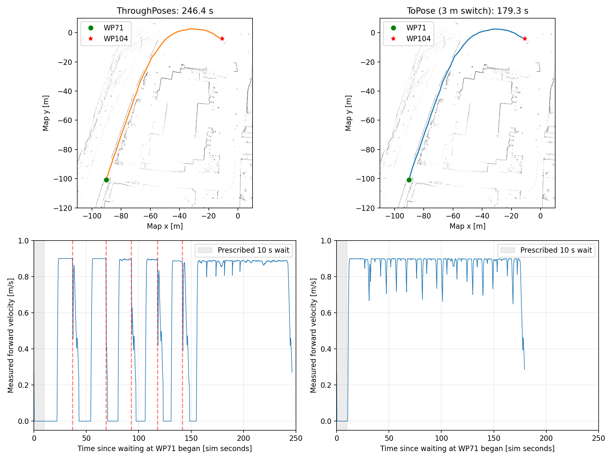

# 中之島sim rosbag比較（2026-10-22）

この2本ではto_pose（sim_nakanoshima2）の方が安定して速い。ThroughPosesでは空の経路による中断・単点再試行が繰り返されている。前回の実機bagの評価とは結果が異なるため、方式一般の優劣に広げず、現在の実装・今回のルートに対する結果とする。

## 入力と条件

- ThroughPoses: `/home/ren/rosbag2_data/sim_nakanoshima/sim_nakanoshima_0.mcap`
- to_pose: `/home/ren/rosbag2_data/sim_nakanoshima2/sim_nakanoshima2_0.mcap`。ユーザー指定に加え、起動ログでもnavigation_mode=to_poseを確認。
- 同じ125地点のルート。to_poseは通常地点の到達判定ログが概ね2.9〜3.0 mで、切替距離は約3 m。
- ThroughPosesの録画は途中（WP30付近）から始まり、to_poseは起動前から記録。全録画時間や総移動距離は直接比較しない。
- シミュレーション時刻を使用。to_poseのbag infoの終了時刻994.238秒より後にも、SequentialReaderで1063秒台までメッセージを読めた。MCAPを開く際にmessage indexがなくfile orderへフォールバックする警告があったため、集計は実際に読み取ったメッセージと共通区間に基づく。

## 同じ停止点WP71→WP104の比較

両方式の`koko_waypoint_follower`が出した「WP71 waiting for 10.0 seconds」から「WP104 waiting for 10.0 seconds」まで。始点の指定待機10秒を含み、終点の待機は含まない。ほぼ同じ到着判定を使う停止点を基準とした。

| 指標 | ThroughPoses | to_pose |
|---|---:|---:|
| 所要時間（sim秒） | 246.399 | 179.330 |
| `/odom`前後速度の絶対値を積分した距離 | 146.99 m | 146.89 m |
| 走行中平均速度（絶対速度>0.05 m/s） | 0.814 m/s | 0.870 m/s |
| 静止時間（指定待機を含む） | 65.38秒 | 10.42秒 |
| Nav2 aborted the waypointの記録数 | 5 | 0 |

静止は|linear.x|<0.03 m/sかつ|angular.z|<0.05 rad/s。to_poseは所要時間が約27%短く、移動距離はほぼ同じ。ThroughPosesは指定待機以外にも約55秒の静止がある。

## エラーと到達

- ThroughPosesの今回の録画内で、`Resulting plan has 0 poses in it.`と対応する`Nav2 aborted the waypoint`が14回発生。
- 続いて`Section failed; retrying the next waypoint alone`が14回。`Skipping failed`は0回で、失敗後は単点再試行で進行している。ループ完了の記録もある。
- 共通区間の中断はWP72/76/79/82/85。停止を指定した場所だけで止まっているわけではない。
- to_poseの`Nav2 aborted the waypoint`は0回。指定待機のキャンセル時に`Failed to get result ... in node halt!`のエラーログはあるため、「エラーログが一切ない」とはしない。
- ThroughPosesの空経路エラーの根本原因はこの比較では確定していない。通過点削除、再計画、controllerへの経路受け渡しなどの整合確認が必要であり、Nav2標準方式そのものが不適切という結論ではない。

## 解釈

今回の設定で運用するならto_poseを選ぶ。ThroughPosesは移動中には約0.9 m/sで走れるものの、中断・再試行が連続走行の利点を相殺している。通過位置の厳密さや障害物余裕は、同じ距離・速度だけでは評価できない。経路追従精度と空経路エラーを改善したうえで再比較する。

rosbagは再生せずread-onlyで解析し、設定・ソース・元bagは変更していない。軌跡は`/odom`とmap→odomの`/tf`を合成した推定値で、厳密な接触・安全性の判定には使用していない。
