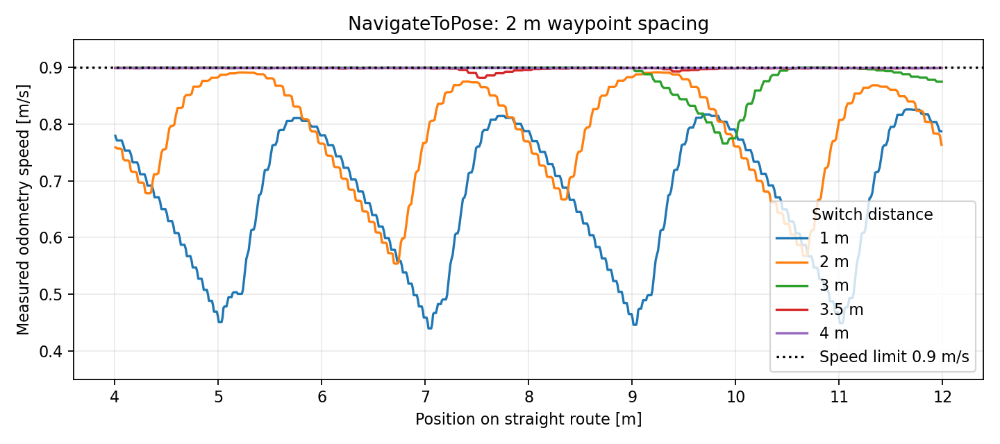

# to_poseの切替距離の直線走行比較（2026-10-20）

現在のsim設定では、切替距離4.0 mで直線途中の速度をほぼ0.9 m/sに維持できた。3.5 mでも落ち込みは小さい。

## 条件

- indoor_facility、NavigateToPose、2 m間隔の直線ポイント（x=2〜16 m、y=0）。
- 現在のparams/sim/nav2.yamlを使用。速度上限0.90 m/s、予測時間2.8秒。
- /odomの実測速度を使用。加速と最終到着の減速を除くx=4〜12 mで集計。
- 自己位置推定はstatic。独立したROS/Gazebo環境で試験し、実機・ユーザーの稼働中simは操作していない。
- 各距離1回の比較。1/2/3 mは往復試験の東向き区間、3.5/4 mはそれぞれsimを起動し直し初期位置・向きを統一。
- 折返し中に経路を外れた4 m試験と、地図サーバー起動不良の試験は除外。

| 切替距離 | 平均速度 | 最低速度 |
|---|---:|---:|
| 1 m | 0.642 m/s | 0.440 m/s |
| 2 m | 0.775 m/s | 0.554 m/s |
| 3 m | 0.887 m/s | 0.766 m/s |
| 3.5 m | 0.898 m/s | 0.882 m/s |
| 4 m | 0.899 m/s | 0.899 m/s |

## 使用方法と適用範囲

追従を起動して走行方式1（NavigateToPose）を選び、中間点の切替距離に4を入力する。既定値・Nav2設定・ウェイポイントは変更していない。

この値は現在のsimの直線に対する結果。曲がり角にも4 mを適用すると早期切替で角を省略しやすいため、必要な地点はYAMLの個別thresholdで小さくする。停止・待機・人物探索・最終到着は従来の判定を維持する。実機や異なる速度・地図条件で同じ速度を保証するものではない。
