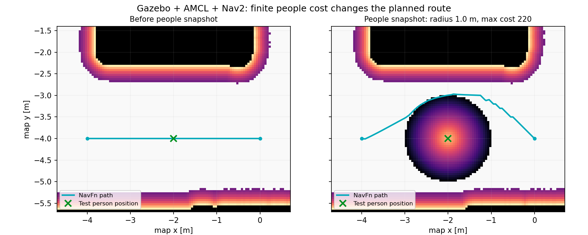

# 外部カメラの人位置をGlobal Costmapへ追加する

ROS 2 Jazzy用のC++ Nav2 Costmap Layerです。`camera-map-checker` の既存実装を確認し、`/external_camera/people` の `geometry_msgs/msg/PoseArray`、Reliable / Volatile / depth=1に合わせています。各メッセージは有効な人位置の**全件スナップショット**で、新しい結果が前の結果を置き換えます。人物ID・姿勢・移動予測は使いません。PoseArrayの配列順もIDとして扱いません。

追加パッケージ内の専用launchだけがシミュレーションのGlobal Costmapを変更します。既存の `params/sim/nav2.yaml`、実機設定、Local Costmap、コントローラ、通常のNav2起動は変更していません。新しいTFも追加していません。

## ビルド

既存のワークスペースとNav2がビルド済みの環境で実行します。

```bash
cd /home/ren/robotbase_ws_renya
source /opt/ros/jazzy/setup.bash
source install/setup.bash
colcon build --symlink-install --packages-select external_camera_people_layer
source install/setup.bash
```

主な依存は `ament_cmake`、`nav2_costmap_2d`、`nav2_util`、`pluginlib`、`rclcpp`、`geometry_msgs` です。手動配信・検証用に `rclpy`、`nav2_msgs`、`lifecycle_msgs`、`rcl_interfaces`、launch用にPyYAMLを使います。テスト時は `ament_cmake_gtest` と `nav2_navfn_planner` が必要です。`package.xml` が依存の正本です。このPCでは既存のJazzy・ワークスペースのNav2 1.3.10を使ってビルドしました。

## カメラなしで試す

ココちゃんランチャーからも起動できます。「🔄 リロード」を押し、
「シミュレーション」タブの `koko_nav2_sim_people`（人位置Layer付きNav2）を選びます。
通常のNav2と以前のGazeboを「シミュレーション一式を終了」で止めてから使ってください。
このプリセットは内寸 **横3.60 m × 縦2.70 m**、厚さ5 cmの外周壁だけの部屋と対応地図を自動選択します。
ロボットの初期位置は部屋中央 `(1.80, 1.35)` です。
上部の「人位置Layer付き自律移動（sim）」なら部屋Gazebo（`koko_sim_room`）・専用Nav2・RVizを起動します。
人位置は手動ノード、またはカメラ側から配信します。部屋内で手動確認する例:

```bash
ros2 run external_camera_people_layer manual_people.py --ros-args -p positions:="[1.8, 0.8]"
```

部屋用の地図は `src/robotbase_sim/maps/room_360x270/room.yaml`。カメラチェッカーの既存部屋用地図と画像・resolution・originが同一です。床の範囲はx=0〜3.60、y=0〜2.70 mです。家具・ドア・開口部はありません。
通常の `koko_sim` と、以下のCLIによる `test_arena` の試験は従来どおり残っています。以下の負の座標や `verify_sim.py` は **test_arena専用** で、部屋プリセットでは使用しません。

以下はそれぞれ**別端末**で実行します。全端末の最初に共通設定を読み込みます。

```bash
cd /home/ren/robotbase_ws_renya
source bash/activate_koko_sim_env.sh
source install/setup.bash
```

シミュレーション用Domain IDは `robot.env` の値（現在67）になります。実機用Domain 54は使いません。既存のGazeboが動作中なら端末1の再起動は不要です。既存Nav2を停止してから、端末2の専用launchを起動してください。

端末1: 既存Gazeboと模擬センサー

```bash
ros2 launch robotbase_sim sim.launch.py
# GUI不要なら末尾に gui:=false
```

端末2: 人用Layerを加えたNav2

```bash
ros2 launch external_camera_people_layer simulation.launch.py \
  params_file:="$PWD/params/sim/nav2.yaml"
```

既定ではGazeboと一致する `test_arena` 地図とAMCLを使用します。RVizの `2D Pose Estimate` で初期位置が必要な場合は `(0, 0)`・向き0を指定します。これはシミュレータの開始位置です。`localization:=static` の既存テストモードを自動で選ぶことはありません。

端末3: 既存RViz

```bash
ros2 launch robotbase_sim rviz.launch.py
```

Fixed Frameを `map` にし、`Global Costmap`（`/global_costmap/costmap`、Map表示のColor Schemeはcostmap）と `Global Plan`（`/plan`）を有効にします。人を表す円状の追加コストがGlobal Costmapへ表示されます。PoseArrayの位置も見たい場合はPoseArray表示を `/external_camera/people` に追加できます。

端末4: 通路上へ手動で人を置く

```bash
ros2 run external_camera_people_layer manual_people.py --ros-args \
  -p positions:="[-2.0, -4.0]" -p frame_id:=map -p publish_rate:=5.0
```

`test_arena` の南側の開けた通路です。位置はm単位の `[x1,y1,x2,y2,...]` で、複数人も送れます。ノードは単調増加時計のタイマーで繰り返し配信するので、シミュレーション停止中も配信できます。ヘッダにはこの配信ノードのROS時刻を入れます。

同じノードへ動的に指示する例（共通設定済みの別端末）:

```bash
# 人を移動
ros2 param set /manual_external_camera_people positions '[-2.0, -3.0]'
# 複数人へ置き換え
ros2 param set /manual_external_camera_people positions '[-2.0, -4.0, -3.5, -4.0]'
# 全員いなくなった状態を繰り返し配信
ros2 param set /manual_external_camera_people positions '[]'
```

起動時から空配列にする場合も `-p positions:="[]"` が使えます。`positions` と `frame_id` は動的に変更可能、`topic` と `publish_rate` は起動時に指定します。`Ctrl-C` でノードを止めた場合は通信タイムアウトで消えます。

**手動ノードと動画配信側を同じトピックへ同時に送らないでください。** 両者の全件スナップショットが交互に上書きします。手動ノードは複数publisherを検出すると警告します。

## 経路への影響を確認する

端末4で人を `(-2,-4)` に置いた状態で、実際のプランナーへ経路だけを要求できます。ロボットの走行指示は送りません。

```bash
ros2 action send_goal /compute_path_to_pose nav2_msgs/action/ComputePathToPose \
  '{start: {header: {frame_id: map}, pose: {position: {x: -4.0, y: -4.0}, orientation: {w: 1.0}}}, goal: {header: {frame_id: map}, pose: {position: {x: 0.0, y: -4.0}, orientation: {w: 1.0}}}, planner_id: GridBased, use_start: true}'
```

人を空配列にして同じ要求を送り、経路が戻るか比較します。通常のNav2 Goalで走行を試す場合も、人の追加・移動後にGlobal Planが更新されるか確認できます。

既存プランナーは `nav2_navfn_planner::NavfnPlanner` のA*です。NavFnは0〜252のコストを移動コストへ反映するため、有限コストのままで迂回を促せます。プランナーのパラメータ調整は行っていません。既存のナビゲーションBTは `RateController hz="1.0"` でComputePathを繰り返す構成です。`expected_planner_frequency` 自体が再計画を起動するわけではありません。

Global Costmapは2 Hzで更新、1 Hzで表示用に配信します。新しい受信情報・消去は次のCostmap更新で反映され、その後に実行された経路計算で利用されます。有限の追加コストなので、迂回が困難な場合や他の経路との評価次第では人の近くを通ることがあります。人物との衝突防止や停止を保証する機能ではありません。Local Costmapと走行制御には今回は追加していません。

## パラメータとLayerの順序

専用launchは指定したシミュレーション用YAMLを読み、**一時ファイル**にGlobal Costmapの差分だけを生成して既存の `robotbase_sim/navigation.launch.py` へ渡します。元YAMLは書き換えません。

既存の順序は `static_layer → obstacle_layer → inflation_layer`。追加時は最後に `people_layer` を置きます。人用Layerは既存のInflationより後で最大値合成を行い、人の円が後段の通常Layerで上書きされることを防ぎます。Keepoutがある地図では既存のFilter処理が続きます。Keepoutの通行禁止はそのまま維持されます。

| Layerパラメータ | 既定値 | 意味 |
| --- | --- | --- |
| `people_layer.enabled` | `true` | 有効／無効。切り替え時は旧情報を破棄 |
| `people_layer.people_topic` | `/external_camera/people` | PoseArrayの購読先。変更時は旧情報・購読を破棄 |
| `people_layer.radius` | `1.0` | コスト半径、m。有限かつ正 |
| `people_layer.max_cost` | `220` | 中心の最大コスト。整数1〜252 |
| `people_layer.timeout` | `1.5` | 最終受信からのタイムアウト、秒。有限かつ正 |

起動時の例:

```bash
ros2 launch external_camera_people_layer simulation.launch.py \
  params_file:="$PWD/params/sim/nav2.yaml" \
  people_radius:=1.2 people_max_cost:=220 people_timeout:=2.0
```

`people_topic:=/another_topic` で購読先を変更できます。`people_enabled:=false` は人用Layerを追加せずに元のシミュレーション設定を使います。`map:=/absolute/path/map.yaml`、`tf_prefix:=robot`、既存の `localization` も指定できます。paramsをコピーインストールする構成や別PCでは `params_file` を明示してください。

稼働中の切り替え例:

```bash
ros2 param set /global_costmap/global_costmap people_layer.enabled false
ros2 param set /global_costmap/global_costmap people_layer.enabled true
ros2 param set /global_costmap/global_costmap people_layer.radius 1.2
ros2 param set /global_costmap/global_costmap people_layer.timeout 2.0
ros2 param set /global_costmap/global_costmap people_layer.max_cost 200
```

無効化・再有効化、reset、Lifecycleのdeactivate／activate後は新しいスナップショットを待ち、以前の入力を復活させません。半径・最大コストの変更では、まだ有効な現在位置を使って円を描き直します。値の検証が成功したパラメータ変更だけを適用します。

## コストと消去の仕様

セル中心から人位置までの距離をd、半径をr、最大値をMとし、`d < r` のセルに `max(1, round(M × (1 − d/r)))` を置きます。中心に近いほど高い線形減衰で、r以上は追加しません。人位置とセル中心が一致しない場合、実際の最大セル値はMより少し小さくなります。

- 人同士の重なり、既存Layerとの重なりは最大値です。足し算やMasterの直接消去は行いません。既存の壁254、内接障害物253を低くしません。
- Masterが未知セル255なら**未知のまま維持**します。人位置だけで既知の自由空間へ変えません。このため未知領域内には人用の有限コストは現れず、未知領域の経路可否は既存の `allow_unknown` に従います。
- NaN・無限大を含む位置は除外します。地図範囲外の人中心は、その円が一部重なっていても除外します。巨大な有限値も整数セルへの変換前に範囲検査します。範囲端の円はクリップします。zの有限性を検査しますが、高さ・向きはコスト計算に使いません。
- 空配列は現在位置を空にします。不正点だけの配列も空の有効集合として扱います。
- 内部Layerのセルを毎更新クリアしてから現在の集合を描き直し、更新範囲には前回と今回の領域の両方を報告します。Nav2がその領域を他のLayerから再合成するので、人が動いた跡だけを消せます。小規模Global Costmap向けの単純な実装で、毎回内部グリッド全体を初期化します。
- 購読・パラメータ変更はmutex付きの入力状態だけを更新し、セル配列には触りません。Boundsで用意した同一のRasterをCostsで使い、途中で届いた新しい結果は次の更新へ回します。購読の作り直しには世代番号を使い、旧購読の待機コールバックを破棄します。
- 人データがなくても `current=true` として、任意の追加コストがない状態でNav2を継続します。これは観測欠損時の安全停止を行うLayerではありません。

## 座標・時刻・カメラ配信との接続

`frame_id` はCostmapのGlobal Frame（現在 `map`）と**完全一致**が必要です。空文字や別フレームなら警告して拒否し、現在の人位置も消します。この版ではTF変換に対応せず、座標を合わせる架空のTFも追加しません。

**同じmapという名前でも、別の地図の座標は一致しません。** カメラ配信側では、今回Nav2へ渡した地図YAMLと参照画像を使用して対応点を設定し直してください。部屋用の270×360 cm地図の設定を、この `test_arena` にそのまま流用できません。カメラ位置・向き・ズーム・画像サイズも対応点設定時と一致する必要があります。実際の部屋の録画を仮想アリーナへ物理的に整合させたことにはなりません。

手動ノードを止めてから、`camera-map-checker` を同じシミュレーション用Domain IDで起動します。配信側の通常ROS時刻と、Nav2の `use_sim_time=true` は異なる時計です。

```bash
# 別端末。同じシミュレーション用Domainの環境を読み込む
source /home/ren/robotbase_ws_renya/bash/activate_koko_sim_env.sh
cd /home/ren/camera-map-checker
./scripts/run_with_ros.sh
```

カメラ側で変換設定を用意して「ROS配信開始」→動画再生を実行します。両足首の低信頼度などで有効な人がいないフレームは空配列となり、Layerから消えます。動画一時停止・シーク・配信停止の空配列でも消えます。処理間隔が長い場合は、`people_timeout` をフレーム間隔より余裕のある値へ調整してください。

Layerは `header.stamp` をタイムアウト判定に使いません。コールバック受信時の `std::chrono::steady_clock` からの経過だけを使うため、異なる時計の差を計算しません。これは撮影からの遅延やネットワーク滞留時間を保証・測定するものではありません。受信前に滞留した古いメッセージを判別する仕組みでもありません。

**Gazeboを一時停止しても通信タイムアウトは進みます。** Nav2のCostmap更新ループはWallRateなので、TFが利用可能で更新中なら内部の人コストを次回更新で消します。ただしNav2の表示用Costmap配信はROS時刻に依存するため、時計停止中のRViz表示は更新が止まる場合があります。その場合は `/global_costmap/get_costmap` サービスで内部値を確認し、再開後の表示を確認します。Nav2自体のLifecycleを停止した場合やTFがなく更新できない場合は、更新再開時に期限切れを反映します。

## 診断・自動確認

```bash
ros2 topic list -t
ros2 topic info /external_camera/people --verbose
ros2 topic echo /external_camera/people geometry_msgs/msg/PoseArray
ros2 param get /global_costmap/global_costmap plugins
ros2 param get /global_costmap/global_costmap people_layer.enabled
ros2 lifecycle get /planner_server
ros2 topic echo /global_costmap/costmap nav_msgs/msg/OccupancyGrid --once
```

既存Nav2が通常起動のままなら `people_layer` は存在しません。専用launchに切り替えます。人位置が来ても変化しない場合は、同じDomain、型・QoS、frame_id、地図の範囲、未知セル、enabled、タイムアウト、Costmap更新、AMCL／TFを確認します。

C++テスト（DDS通信するためネットワークのローカルソケットを使用）:

```bash
export ROS_DOMAIN_ID=96 ROS_AUTOMATIC_DISCOVERY_RANGE=LOCALHOST
unset ROS_LOCALHOST_ONLY
colcon test --packages-select external_camera_people_layer
colcon test-result --test-result-base build/external_camera_people_layer --verbose
```

Gazeboと専用Nav2を起動済みなら、手動配信ノード・カメラ配信を止めて次を実行できます。シミュレーション用の同じDomainを使ってください。

```bash
ros2 run external_camera_people_layer verify_sim.py \
  --output /tmp/external_camera_people_layer_check.json
```

この検証は `test_arena` の指定通路に人位置を配信し、Global Costmapを読み、実際のComputePathToPoseアクションで比較します。途中でLayerを無効化・再有効化し、最後は空配列を送ります。走行ゴールや速度指令は送りません。試験用のシミュレーションで実行してください。出力JSONには経路とCostmapの値も含みます。

## 2026-10-19の確認結果

作業ブランチは `renya/camera-nav`。作業開始時に未コミット変更はなく、適用対象のAGENTS.mdはありませんでした。mainへの切り替え、push、マージは行っていません。

- C++の11テスト: 円形減衰・最大値、旧領域／内部セル消去、壁・未知維持、範囲端、NaN／無限大／巨大座標、別frame拒否、停止したROS時計での期限切れ、無効化／再有効化／reset／Lifecycle、半径縮小・値検証、BoundsとCostsの間の受信、並行更新、トピック切替、実NavFnの迂回を検証。
- 手動ノード: 空配列での起動、複数人への動的変更、再度空配列、奇数個の座標の拒否、ROS時計が0のままでも周期配信できることを実受信で確認。
- 既存Gazebo `test_arena`＋模擬センサー＋AMCL＋Nav2で、専用Domain 97を用いて実行。Nav2のLifecycle activeとpluginロードを確認し、人の追加・移動・複数人・空配列・通信断・無効化／再有効化・不正frame・不正座標・壁の維持を実際のGlobal Costmapで確認。
- 実ComputePathToPoseの経路は、人を置く前は人予定位置を通過し、追加後は中心から約0.98 m離れる経路に変化。空配列後は元の経路へ戻りました。最終受信後の消去は試行時約1.5秒。半径1.0 m・最大220・timeout1.5秒を使用しました。
- GPUを使わない仮想画面での試験では、`LIBGL_ALWAYS_SOFTWARE=1` を強制するとMesa/EGLがクラッシュしました。これを外し、`GALLIUM_DRIVER=llvmpipe`、Xvfbで既存Gazeboを起動して上記を確認しています。既存のworld・モデル・実機設定は変更していません。
- 実機、実カメラ／録画の座標とシミュレーション地図の整合、走行中の継続再計画・ゴール到達、Gazebo GUIを操作して停止した状態の試験は未確認です。時計停止時の期限切れはC++テストで確認しています。

結果の要約は [verification/result.json](verification/result.json)。以下は実際に取得したGlobal Costmapとプランナー経路で、実測した人の位置精度を表すものではありません。



### 部屋プリセットの確認

内寸横3.60 m・縦2.70 m、厚さ5 cmの外周4壁だけであることと、カメラチェッカーの地図3ファイルが同一であることを確認しました。独立Domain 100のGazeboで模擬Scan・AMCL・Nav2の起動を確認し、中央の自己位置 `(1.80, 1.35)`、人位置 `(1.8, 0.8)` のコスト218、空配列後の消去、壁コスト254の維持を実受信で確認しています。[結果](verification/room_result.json)。ランチャーテスト9件も成功しています。
